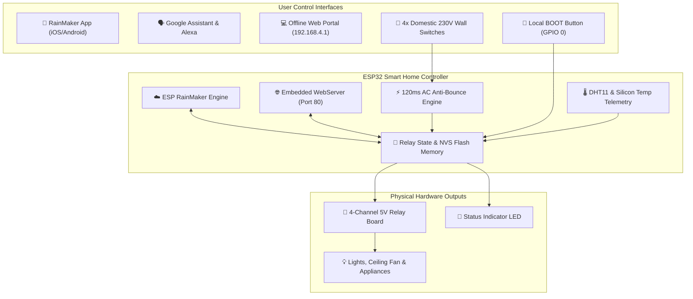

# 🏠 ESP32 Smart Home Automation Hub (Dual-Mode Cloud & Offline System)

[](https://www.espressif.com/)
[](https://platformio.org/)
[](https://rainmaker.espressif.com/)
[](https://kicad.org/)
[]()
[](LICENSE)

An industrial-grade, production-tested **Smart Home Automation Ecosystem** supporting both **ESP32-WROOM-32** and **ESP32-S3** microcontrollers.  
Combines **free worldwide cloud control** (ESP RainMaker + Google Home + Alexa) with an **instant fallback offline web dashboard (`192.168.4.1`)**, **230V AC physical wall switch 2-way synchronization**, **DHT11 climate monitoring**, **wireless Web OTA updating**, and custom-designed **isolated dual-rail power & optocoupler PCBs**.

---

## 🌟 Key Highlights & Capabilities

* 🌍 **ESP RainMaker Cloud Backbone:** 100% free, zero-subscription worldwide control via native iOS & Android mobile apps. Zero port-forwarding or public IP configuration required.
* 🗣️ **Native Voice Assistant Integration:** Works seamlessly with **Google Assistant** and **Amazon Alexa** (*"Hey Google, turn on Light 1"*, *"Alexa, turn off the Fan"*).
* 📶 **Automated Fallback Offline Web Portal:** If Wi-Fi or mobile hotspot drops for > 10 seconds, the ESP32 automatically creates a local Wi-Fi Access Point (`SmartHome_Offline`) and serves a responsive dark-mode PWA dashboard at `http://192.168.4.1/`. Automatically switches back to cloud when Wi-Fi recovers.
* 🔄 **4-Channel 230V AC Wall Switch 2-Way Sync:** Uses Sharp **PC814** optocouplers (5,000V galvanic isolation) + 10µF zero-crossing filtering + 120ms software debounce to detect physical household wall switch flips without interference.
* ⚡ **Custom Industrial Dual-Rail Power Supply PCB:** Hi-Link **HLK-10M05** switching module delivers **+5.0V @ 2.0A** for relay coils and **+3.3V @ 1.0A** (AMS1117-3.3) for logic. Features a 2A fuse, 14D471K MOV surge clamp, 10D-9 NTC inrush limiter, 1000µF Low-ESR filter, and 2.0mm PCB creepage slot.
* 🌡️ **Comprehensive Telemetry:** Real-time ambient room temperature (°C) & humidity (% RH) via DHT11, internal ESP32 silicon die temperature, and live Wi-Fi link quality / RSSI.
* 💾 **NVS Power Outage State Recovery:** Saves relay states and custom channel names to Flash Non-Volatile Storage (`Preferences`). When mains power recovers after a blackout, appliances immediately restore their exact prior states.
* ⚡ **Wireless Web OTA Updates:** Flash new firmware wirelessly from any phone or PC browser via `http://<ESP32-IP>/update` using dual-OTA partitions (`ota_0` / `ota_1`).
* 🚀 **1-Click Flasher Tools:** Double-click automated Windows batch scripts to flash brand new ESP32 chips over USB without requiring PlatformIO, VS Code, or Python installation.

---

## 🏗️ High-Level System Architecture



---

## ⚡ Master Hardware Pinout Matrix

| Peripheral / Channel | ESP32-WROOM-32 Pin | ESP32-S3 DevKitC-1 Pin | Electrical Logic |
| :--- | :---: | :---: | :--- |
| 💡 **Relay 1 (Light 1)** | `GPIO 23` | `GPIO 10` | Digital Output, Active LOW |
| 💡 **Relay 2 (Light 2)** | `GPIO 22` | `GPIO 11` | Digital Output, Active LOW |
| 🌀 **Relay 3 (Fan)** | `GPIO 21` | `GPIO 12` | Digital Output, Active LOW |
| 🔌 **Relay 4 (Appliance)** | `GPIO 19` | `GPIO 13` | Digital Output, Active LOW |
| 🔲 **Wall Switch 1 (Opto)** | `GPIO 32` | `GPIO 1` | Digital Input, Internal Pull-Up, Active LOW |
| 🔲 **Wall Switch 2 (Opto)** | `GPIO 33` | `GPIO 2` | Digital Input, Internal Pull-Up, Active LOW |
| 🔲 **Wall Switch 3 (Opto)** | `GPIO 25` | `GPIO 41` | Digital Input, Internal Pull-Up, Active LOW |
| 🔲 **Wall Switch 4 (Opto)** | `GPIO 26` | `GPIO 42` | Digital Input, Internal Pull-Up, Active LOW |
| 🌡️ **DHT11 Climate Sensor** | `GPIO 4` | *(Optional)* | 1-Wire Single Bus (4.7kΩ Pull-Up) |
| 🔵 **Status LED** | `GPIO 2` (Blue LED) | `GPIO 48` (WS2812 RGB) | Solid = Online, Blink = AP / Sync |
| 🔘 **Manual BOOT Switch** | `GPIO 0` | `GPIO 0` | Momentary Pull-up (Toggles Light 1) |

---

## 📂 Repository Directory Structure

```
ESP32_Home_Automation_Repository/
│
├── agent_docs/                           <-- 🤖 Specialized AI Agent Context & Knowledge Base
│   ├── 00_AI_AGENT_README.md             <-- Master guidelines for AI assistants
│   ├── 01_SYSTEM_ARCHITECTURE.md         <-- FreeRTOS, RainMaker & WebServer blueprint
│   ├── 02_PINOUT_AND_HARDWARE_MAP.md     <-- Complete pin assignments & strapping constraints
│   ├── 03_AC_OPTOCOUPLER_LOGIC.md        <-- 230V AC zero-crossing & anti-bounce filter math
│   ├── 04_POWER_SUPPLY_SPECIFICATION.md  <-- HLK-10M05 dual supply & creepage clearance
│   ├── 05_NVS_AND_PARAM_DICTIONARY.md    <-- Preferences keys & RainMaker parameter schema
│   ├── 06_FIRMWARE_STATE_MACHINE.md      <-- Boot, Wi-Fi retry, AP mode & loop timings
│   ├── 07_TROUBLESHOOTING_MATRIX.md      <-- Root cause & fix guide for boot, brownout, Wi-Fi
│   └── 08_AGENT_PROMPT_COOKBOOK.md       <-- Copy-paste prompt templates for new features
│
├── firmware/
│   ├── esp32_wroom_production/           <-- ESP32-WROOM-32 4MB Firmware (Production Stack)
│   │   ├── src/                          <-- config.h & main.cpp
│   │   ├── bin/                          <-- Precompiled factory binaries
│   │   ├── partitions_wroom_4MB.csv      <-- Dual-OTA partition table
│   │   ├── platformio.ini                <-- Build environment
│   │   └── flash_wroom.bat               <-- 1-Click flasher
│   │
│   └── esp32_s3_16mb/                    <-- ESP32-S3 DevKitC-1 16MB Firmware
│       ├── src/                          <-- config.h & main.cpp
│       ├── bin/                          <-- Precompiled S3 binaries
│       ├── partitions_rainmaker_16MB.csv <-- 16MB partition definitions
│       ├── bootloader_dio.bin            <-- DIO mode bootloader
│       └── platformio.ini                <-- Build environment
│
├── hardware/
│   ├── 5v_power_supply_module/           <-- 220V AC to 5V/3.3V Isolated Power Supply (KiCad)
│   │   ├── 5V_Power_Supply.kicad_*       <-- KiCad schematic & PCB files
│   │   ├── 5V_Power_Supply_Schematic.pdf <-- High-res vector schematic
│   │   ├── BOM.csv                       <-- Component sourcing list
│   │   ├── production/                   <-- Gerber Zip, CPL, drill files for JLCPCB/PCBWay
│   │   └── renders/                      <-- 3D isometric PCB renders
│   │
│   ├── optocoupler_4ch_module/           <-- 4-Channel 230V AC Optocoupler Interface (KiCad)
│   │   ├── Optocoupler_4CH.kicad_*       <-- KiCad schematic & PCB files
│   │   ├── production/                   <-- Gerber Zip & JLCPCB assembly files
│   │   └── renders/                      <-- Top & Bottom PCB renders
│   │
│   └── wiring_and_pinouts/               <-- Wiring guides & electrical safety manuals
│       ├── WIRING_GUIDE_WROOM.md
│       ├── WIRING_GUIDE_S3.md
│       └── MAINS_SAFETY_CHECKLIST.md
│
├── docs/                                 <-- End-user and operational documentation
│   ├── RAINMAKER_APP_SETUP_GUIDE.md      <-- App pairing, Alexa & Google Home linking
│   ├── OFFLINE_WEB_PORTAL_GUIDE.md       <-- Using 192.168.4.1 dashboard & renaming
│   ├── OTA_UPDATE_GUIDE.md               <-- Wireless browser flashing procedure
│   └── COMPLETE_BREADBOARD_TO_PCB.md     <-- Enclosure, wiring, and manufacturing guide
│
├── tools/                                <-- Standalone 1-click batch flashing tools
│   ├── flash_esp32_wroom.bat
│   ├── flash_esp32_s3.bat
│   └── README_TOOLS.md
│
├── .gitignore                            <-- Clean git rules (preserves binaries, ignores caches)
└── LICENSE                               <-- Private & Confidential Proprietary License
```

---

## 🚀 Quickstart: Flashing Your ESP32 in 60 Seconds

### For ESP32-WROOM-32 (Most Common):
1. Connect your ESP32-WROOM board to your PC via a micro-USB cable.
2. Navigate to `tools/` and double-click **`flash_esp32_wroom.bat`**.
3. The tool auto-detects your COM port and flashes the complete system package in under 30 seconds.
4. Follow the [RainMaker App Setup Guide](docs/RAINMAKER_APP_SETUP_GUIDE.md) to pair with your phone!

### For ESP32-S3 (16MB):
1. Connect your ESP32-S3 board to your PC via a USB-C cable.
2. Navigate to `tools/` and double-click **`flash_esp32_s3.bat`**.

---

## 🤖 For Future AI Coding Agents
If you are an AI assistant tasked with adding new features (e.g., adding an OLED display, adding PZEM-004T energy monitoring, upgrading to 8 channels, or configuring Home Assistant MQTT), read the dedicated AI manual first:  
👉 [**`agent_docs/00_AI_AGENT_README.md`**](agent_docs/00_AI_AGENT_README.md)
