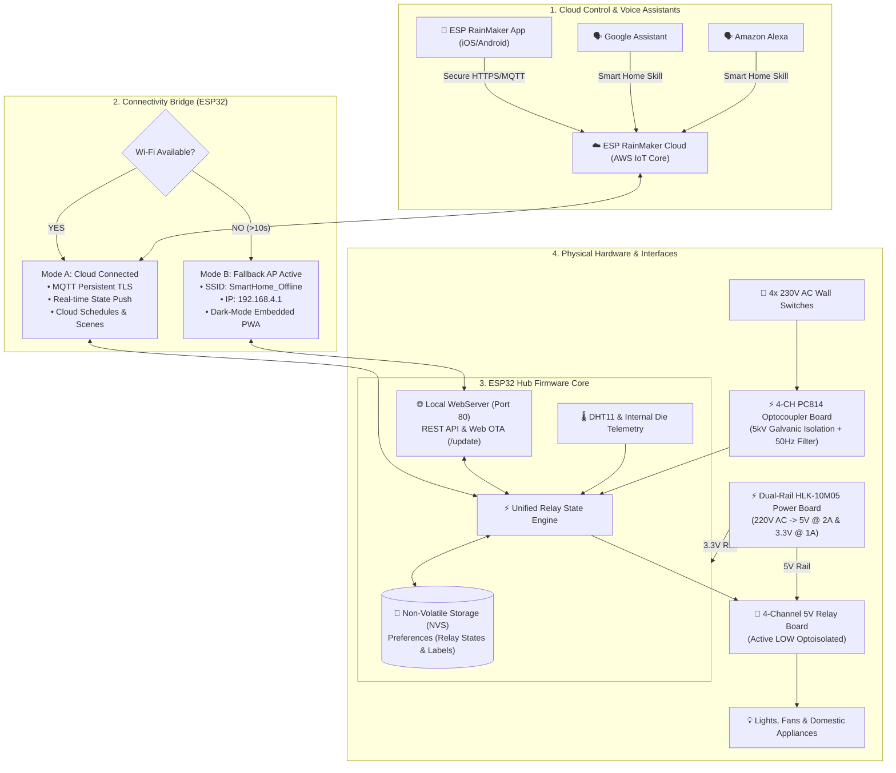

# 🏛️ System Architecture Blueprint

## 🌐 High-Level System Overview

The system operates on an **autonomous hybrid IoT architecture** designed to guarantee uninterrupted local home automation even if internet connectivity or the cloud backbone becomes unreachable.



---

## 🔄 Dual Connectivity Architecture

### Mode A: ESP RainMaker Cloud (Online Mode)
1. **Protocol:** MQTT over Mutual TLS (Port 8883) connecting to AWS IoT Core endpoints hosted by Espressif.
2. **Provisioning:**
   - Supported via Wi-Fi Provisioning over BLE (Bluetooth Low Energy) or SoftAP.
   - Proof of Possession (PoP): `smart123` (configured in `config.h`).
   - Generates persistent node ID on the RainMaker cloud.
3. **Features Enabled:**
   - Worldwide 4G/5G mobile control without port forwarding or dynamic DNS.
   - Google Home and Amazon Alexa smart home integration.
   - Timezone-synced local RTC clock for on-device timers that execute even if the cloud momentarily disconnects.
   - Custom parameters: `Temperature`, `Humidity`, `Die Temp`, `WiFi Signal`.

### Mode B: Automated Fallback Offline Portal (Local Mode)
1. **Trigger Condition:** Wi-Fi router or mobile hotspot connection lost for > 10 seconds.
2. **Access Point Credentials:**
   - **SSID:** `SmartHome_Offline`
   - **Password:** `12345678`
   - **Default Gateway IP:** `192.168.4.1`
   - **mDNS Hostname:** `http://smarthome.local/`
3. **Embedded PWA Dashboard:**
   - Stored directly in ESP32 Flash memory (`PROGMEM`) — requires NO external SD card or LittleFS flash partitions.
   - Fully responsive dark-mode UI with dynamic SVG toggles, live DHT11 telemetry gauges, master switches ("All ON", "All OFF"), and inline switch renaming.
4. **Auto-Recovery:**
   - The ESP32 continuously scans for the configured Wi-Fi credentials in the background. Once the home router or hotspot is turned back on, the ESP32 automatically disconnects the fallback AP and reconnects to RainMaker cloud within seconds.

---

## 🔁 2-Way State Synchronization Model

The system ensures that **no matter which interface** toggles a load (physical wall switch, smartphone app, Google Home voice command, local web browser, or physical BOOT button), all states remain 100% in sync:

```
[Physical Wall Switch] ──► [Optocoupler] ──┐
                                           │
[RainMaker Mobile App] ──► [AWS Cloud] ────┼──► [Relay State Engine] ──► [Physical Relay]
                                           │               │
[Offline Web Portal]   ──► [HTTP REST] ────┤               ▼
                                           │      [NVS Flash Memory]
[BOOT Push Button]     ──► [GPIO 0] ───────┘      (Survives Power Loss)
```

1. **Physical Wall Switch:** Toggling an AC wall switch alters the optical signal across the PC814 optocoupler. The firmware's debounced edge detector identifies the transition and toggles the corresponding relay channel.
2. **Instant Cloud & Web Feedback:** The `StateEngine` updates the hardware pin, commits the new boolean state to Non-Volatile Storage (`Preferences`), and immediately reports the new state to both the RainMaker cloud parameter and local HTTP clients.
3. **Power Outage Resilience:** When mains power is restored after a blackout, `main.cpp` reads the stored states from NVS namespace `"relays"` and immediately returns every relay to its exact pre-blackout state within 15 milliseconds.

---

## ⚡ Over-The-Air (OTA) Firmware Updates

The ESP32-WROOM production build incorporates a dual-partition OTA engine:
- **Partition Scheme:** `ota_0` (1.8MB) and `ota_1` (1.8MB) managed via `partitions_wroom_4MB.csv`.
- **Web Interface:** Accessible via browser at `http://<ESP32-IP>/update` or `http://192.168.4.1/update`.
- **Security:** Standard HTTP POST handler with flash boundary verification and automatic rollback if flashing is interrupted or corrupted.
