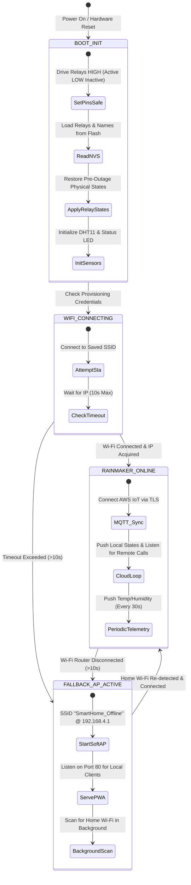

# 🔄 Firmware State Machine & Event Loop

## 📊 High-Level State Transition Diagram



---

## ⏱️ Main Event Loop Timing & Task Budget

The main `loop()` executes continuously on Core 1 without any blocking `delay()` calls. Tasks run on timed intervals:

```
+─────────────────────────────────────────────────────────────+
|                     MAIN LOOP CYCLE                         |
+─────────────────────────────────────────────────────────────+
  │
  ├── 1. checkWallSwitches()      [Runs EVERY iteration (~10µs)]
  │      Reads 4x PC814 inputs with 120ms anti-bounce window.
  │
  ├── 2. checkBootButton()        [Runs EVERY iteration (~5µs)]
  │      Detects short-press toggle on GPIO 0 (Light 1).
  │
  ├── 3. server.handleClient()    [Runs EVERY iteration (~20µs)]
  │      Serves HTTP requests & REST API on port 80.
  │
  ├── 4. updateStatusLed()        [Runs EVERY iteration (~5µs)]
  │      Non-blocking LED cadence engine (Solid, Blink, Pulse).
  │
  ├── 5. readDHTTelemetry()       [Runs every 3,000ms]
  │      Interrogates DHT11 single-bus data with error check.
  │
  ├── 6. pushCloudTelemetry()     [Runs every 30,000ms]
  │      Reports Temperature, Humidity & Wi-Fi RSSI to Cloud.
  │
  └── 7. checkNetworkHealth()     [Runs every 5,000ms]
         Monitors Wi-Fi link; switches between Cloud & AP mode.
```

---

## 🛡️ Critical Safety Mechanism: Anti-Chatter at Boot

Standard Arduino examples initialize pins like this:
```cpp
// ❌ WRONG: Causes relay contacts to spark/click on power up!
pinMode(RELAY_PIN, OUTPUT);
digitalWrite(RELAY_PIN, HIGH);
```
During the microsecond gap between `pinMode()` (which sets the pin LOW by default) and `digitalWrite(HIGH)`, the Active-LOW relay momentarily clicks ON and OFF.

**The Production Implementation in This Repository:**
```cpp
// ✅ CORRECT: Zero contact bounce or click during boot!
digitalWrite(RELAY_PIN, HIGH); // Pre-set latch register to inactive
pinMode(RELAY_PIN, OUTPUT);    // Set mode; pin immediately drives HIGH
```
Any future AI agent modifying pin initialization must strictly follow this pattern!
